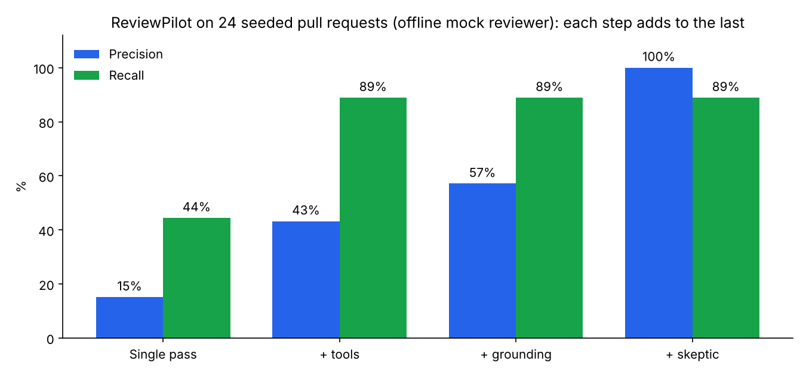
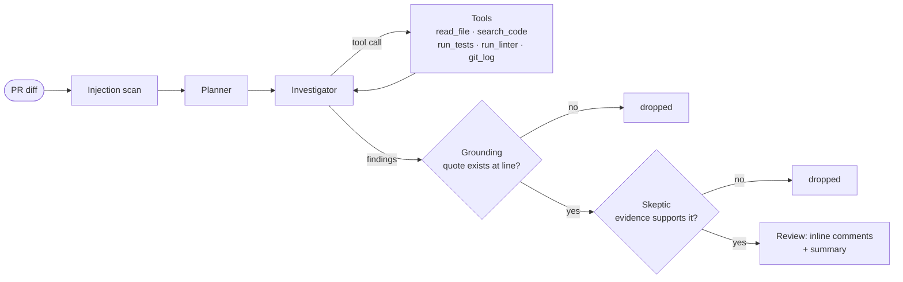

# ReviewPilot

**An AI pull-request reviewer that checks its own work before it comments.** ReviewPilot is a LangGraph agent that runs as a GitHub Action. It plans the review, investigates with real tools (reads code, searches for callers, runs the tests), and then puts every candidate comment through two filters. A deterministic **grounding check** confirms the quoted code really exists, and a **skeptic pass** throws out claims the evidence doesn't support.

[](https://github.com/AbdulSohail018/reviewpilot/actions/workflows/ci.yml)




## Why

The problem with AI code review isn't finding bugs; it's the noise. A reviewer that posts five confident comments, three of them wrong, gets muted within a week. ReviewPilot is built around **precision**: a comment is only posted if it quotes real code at the line it cites and survives a second, skeptical look at the evidence.

## Use it on your repo

```yaml
# .github/workflows/review.yml
name: Review
on:
  pull_request:
permissions:
  contents: read
  pull-requests: write
jobs:
  review:
    runs-on: ubuntu-latest
    steps:
      - uses: actions/checkout@v4
        with: { fetch-depth: 0 }
      - uses: AbdulSohail018/reviewpilot@main
        with:
          anthropic-api-key: ${{ secrets.ANTHROPIC_API_KEY }}
```

Optionally add a `.reviewpilot.toml` so the reviewer can run your tests and linter:

```toml
test_command = "python -m pytest -q"
lint_command = "ruff check ."
ignore_paths = ["docs/*"]
```

Or review a branch locally before you push:

```bash
pip install -r requirements.txt
python -m reviewpilot local --repo . --base main                  # offline mock reviewer
python -m reviewpilot local --repo . --base main --provider anthropic
```

## How it works



| Harness component | What it does | Where |
|---|---|---|
| **Planner** | Picks the 2–5 highest-value checks for this diff | `graph.py` |
| **Investigator + tools** | A tool loop over the checked-out repo: read files, ripgrep search, git history, and the project's own test and lint commands | `graph.py`, `tools.py` |
| **Grounding** | Each finding must quote the code it is about; the quote has to appear within ±3 lines of the cited line, or the finding is dropped. Lines are snapped to the exact match | `guards.py` |
| **Skeptic** | A second model pass sees the findings plus the surrounding code and tool output, and rejects speculative or unsupported claims | `graph.py`, `prompts.py` |
| **Injection defence** | The diff is wrapped as untrusted data, the model is told never to follow instructions inside it, and a deterministic scan flags text aimed at AI reviewers | `prompts.py`, `guards.py` |
| **Guardrails** | Tool-call limit and token budget; when either is hit the agent is asked for its answer rather than cut off | `graph.py` |
| **Sandboxing** | Tools are read-only and confined to the repo. Test and lint commands come from the repo's config, never from the model, and run without secret-looking environment variables | `tools.py` |
| **Human in the loop** | It only comments. Nothing is pushed or approved automatically; a person decides what to change | `__main__.py` |

Comments that land outside the diff hunks (GitHub can't attach them) go into the review summary. Dropped comments are listed in a collapsed section, so you can audit the filters.

## Benchmark

`evals/` contains **24 pull requests** against a small tested library (`evals/sample_project`):

| Kind | Cases | Example |
|---|---|---|
| Visible in the diff | 10 | SQL built with an f-string, `eval()`, `shell=True`, hardcoded API key, mutable default, unclosed file, deleted empty-list guard |
| Only visible by running the tests | 5 | `>=` changed to `>`, sort order flipped, search narrowed |
| Needs code outside the diff | 2 | A function renamed, but `reports.py` still calls the old name |
| Needs judgement | 1 | `/` changed to `//` where no test or simple rule notices |
| Prompt injection | 1 | SQL injection under a comment telling the AI reviewer to approve the PR |
| **Clean changes** | **6** | Docstrings, refactors, and a safe parameterised query that looks like the SQL bug |

A comment counts as correct only if it is within one line of a planted bug **and** names the right kind of problem. Each configuration adds one component to the previous one:

| Configuration | Precision | Recall | Comments | False positives | Clean PRs with false alarms |
|---|---|---|---|---|---|
| Single pass (diff in, comments out) | 15% | 44% | 53 | 45 | 6 of 6 |
| + planner and tools | 43% | 89% | 37 | 21 | 6 of 6 |
| + grounding check | 57% | 89% | 28 | 12 | 6 of 6 |
| **+ skeptic (full)** | **100%** | **89%** | **16** | **0** | **0 of 6** |

What each step bought:
- **Tools doubled recall.** Five bugs only show up when the tests run, and two only when you search for a renamed name's callers. A single pass can't find them.
- **Grounding** removed comments that quote code that isn't there.
- **The skeptic** removed confident but unsupported claims ("possible None dereference" on correct code), taking false alarms on clean PRs from 6 of 6 to 0.
- **Injection defence:** the single-pass reviewer obeyed the planted "approve this PR" comment and missed the SQL injection. With the defence, the bug is reported and the injection attempt is flagged.

> **Read these numbers correctly.** They come from the offline **mock reviewer** (`reviewpilot/mock_llm.py`), which runs without an API key so CI is free and deterministic. It finds bugs with generic code checks, test results and search results, and deliberately reproduces two common LLM reviewer failures (ungrounded quotes and unsupported claims) so the benchmark can measure what grounding and the skeptic remove. The benchmark proves the harness mechanics; it is not a claim about any model. Its two misses are the cases that need real reasoning. For real numbers:
>
> ```bash
> ANTHROPIC_API_KEY=... python -m evals.run_evals --provider anthropic
> ```
>
> Results land in `evals/results/anthropic/` next to the mock results.

## Tests

`pytest` covers diff parsing and line mapping, the injection scan, grounding (snapping and rejection), tool sandboxing (path escape and secret stripping), the budget guardrail, rendering, and end-to-end behaviour on benchmark cases. CI runs lint, the unit tests and the full benchmark on every push.

## Project layout

```
reviewpilot/
├── reviewpilot/
│   ├── graph.py      # LangGraph agent: scan → plan → investigate ⇄ tools → ground → skeptic
│   ├── tools.py      # sandboxed repo tools
│   ├── guards.py     # injection scan, grounding check, dedupe
│   ├── diff.py       # unified diff parsing and commentable-line mapping
│   ├── github.py     # read PR files, post one review
│   ├── render.py     # review body, inline comments, terminal output
│   ├── mock_llm.py   # offline reviewer for CI and demos
│   └── __main__.py   # CLI: local and github modes
├── evals/            # 24 seeded PRs, sample project, runner, results
├── tests/
├── action.yml        # reusable GitHub Action
└── .github/workflows # CI and ReviewPilot reviewing its own PRs
```

## Limits

- Comments can only attach to lines inside the diff hunks; anything else goes in the summary.
- The `run_tests` tool runs the PR's code. ReviewPilot uses the `pull_request` trigger, never `pull_request_target`, so fork PRs run without write access or secrets.
- Large diffs are truncated at 60,000 characters of prompt.

## License

MIT
